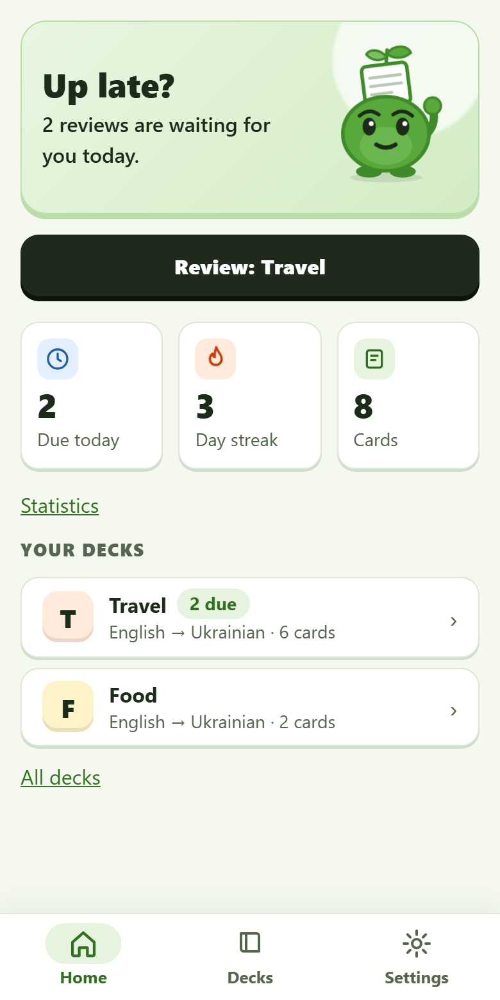
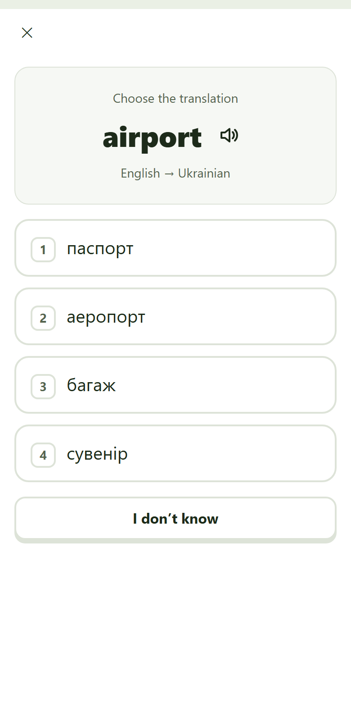
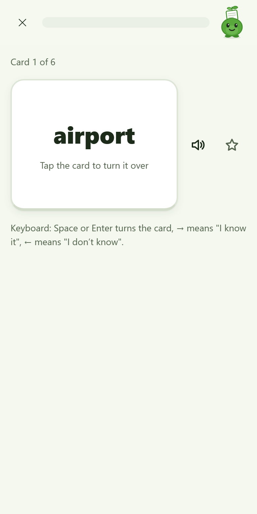
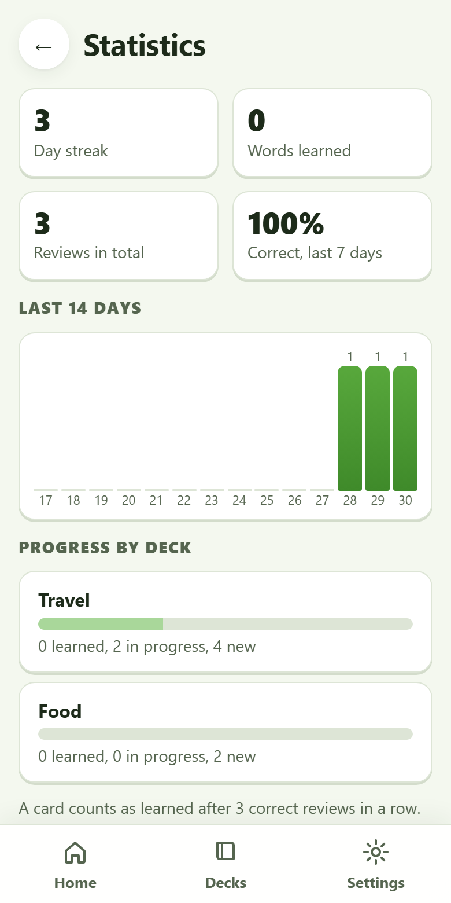
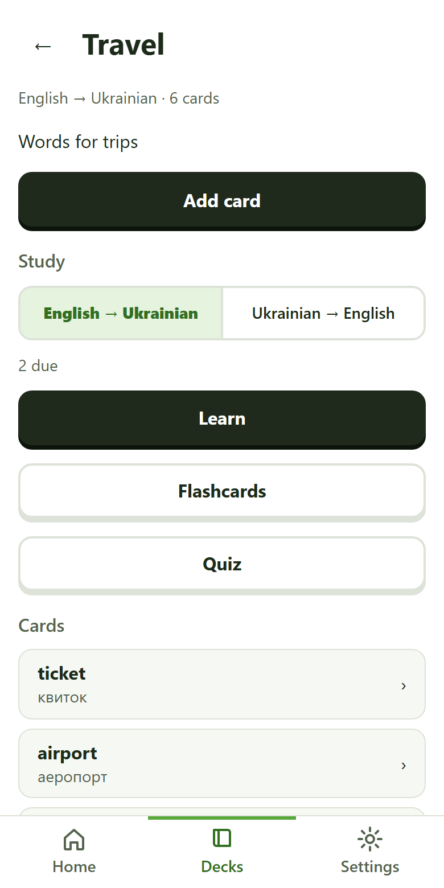
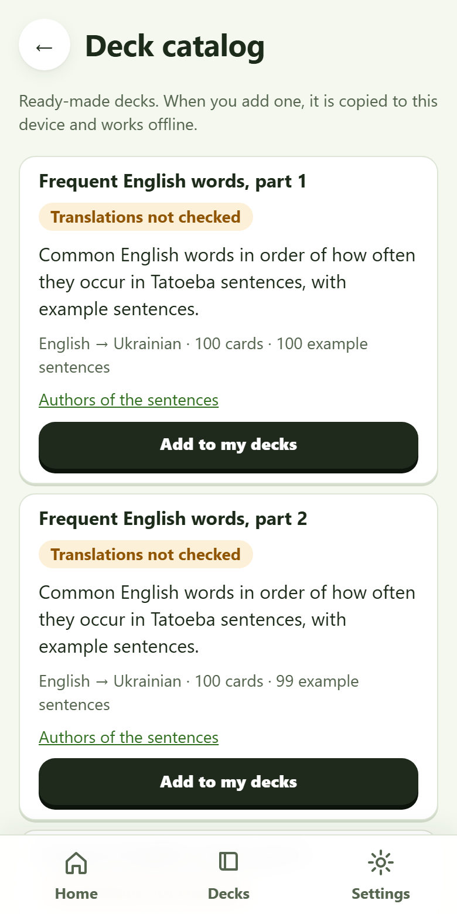
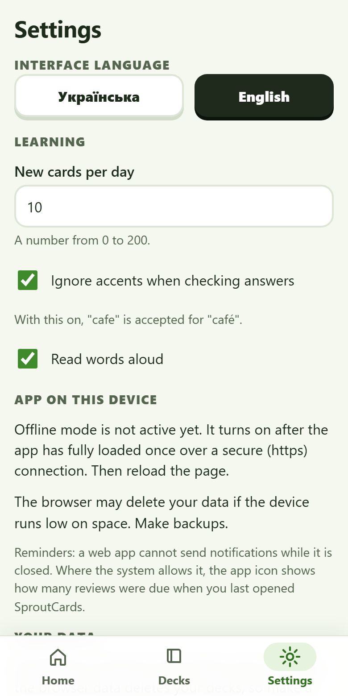

# SproutCards

Flashcards for learning any language, as an installable web app (PWA) that works offline. Your decks and
progress stay on your device: there are no accounts, no servers of its own, no analytics.

The first language pair is English ↔ Ukrainian, but nothing in the code is tied to it: a deck just names two
language codes (`en`, `uk`, `de`, `pt-BR`…). The interface is available in Ukrainian and English.

<p>
  
  
  
  
</p>
<p>
  
  
  
</p>

## What it does

- **Study modes:** *Learn* (multiple choice, then typing, then the reverse direction; mistakes come back a few
  cards later), *Flashcards* (flip and answer "I know / I don't know"), *Quiz* (graded, does not change the
  schedule). Both directions (word → translation and back) have separate progress.
- **Answer checking:** ignores case, spaces and (optionally) accents; a small typo gives "Almost" with the
  right answer shown instead of a plain "wrong".
- **Spaced repetition:** fixed intervals of 1, 3, 7, 14 and 30 days. The scheduler sits behind a small
  interface, so it can be replaced by SM-2 or FSRS later.
- **Your own decks:** create decks and cards, import and export (JSON; CSV for cards), full backup file.
  Importing never overwrites anything.
- **Catalog of ready-made decks:** three parts of 100 frequent English words and a small "Travel" deck, each
  word with an example sentence. Loaded on demand, then stored on the device. See
  [Content and licences](#content-and-licences).
- **Statistics:** day streak, words learned, accuracy, a 14-day activity chart, progress per deck.
- **Speech:** reads words aloud with the device's own voices (Web Speech API); explains it when the device
  has no voice for the language.
- **Offline and installable:** after the first load it opens without a network. Updates are offered, never
  forced in the middle of a lesson, and never touch your data.
- **Accessible:** keyboard control (1–4, Enter, Space, arrows), labelled buttons, visible focus, contrast
  checked, never colour alone.

## Run it

You need Node.js 24 or newer (the build scripts run TypeScript directly) and npm.

```
npm ci
npm run dev        # development server (open the address it prints)
```

Open `http://localhost:5173/?seed` once to fill an empty database with demo decks (development server only;
this code is not part of the production build).

| Command | What it does |
|---|---|
| `npm run dev` | development server |
| `npm run build` | type check and production build into `dist/` (plus the service worker) |
| `npm run preview` | serves `dist/` locally, to try the installable/offline version |
| `npm run lint` · `npm run typecheck` · `npm run test` | the checks that must pass before every commit |
| `npm run format` | Prettier |
| `npm run cap:sync` | builds the site and copies it into the Android and iOS projects |
| `npm run check:offline` | real Chrome: offline start and update without data loss (after `npm run build`) |
| `npm run check:headers` | real Chrome: the hosting headers (incl. Content-Security-Policy) do not break the built app |
| `npm run check:a11y` | real Chrome: axe-core accessibility rules on 12 screens (with `npm run dev` running) |

Service workers need `https` or `localhost`, so test offline/installing with `npm run preview` or a hosted
copy, not by opening `dist/index.html` from the disk.

## Stack

TypeScript (strict), React 19, Vite 8, `vite-plugin-pwa` (Workbox), IndexedDB through Dexie, React Router (hash
routing, so any static host works), Vitest + Testing Library. No state library, no UI kit, no chart library.

## How the code is organised

```
src/core    pure logic, no React, no browser APIs: answer checking, scheduler, Learn engine, quiz,
            import/export, statistics (fully unit-tested)
src/db      Dexie schema and repository (the only code that talks to storage)
src/i18n    translations (uk, en) and plural rules
src/ui      screens, components, study sessions, PWA state
scripts     catalog building from open data, icon generation, real-browser checks
public      icons, manifest assets, the deck catalog (static JSON files)
docs        ARCHITECTURE, DESIGN, DATA_SOURCES, HOW_IT_WORKS, IPHONE_TEST
```

Read [docs/ARCHITECTURE.md](docs/ARCHITECTURE.md) for the details (layers, algorithms, offline strategy,
storage and migrations). Documents for the project owner ([JOURNAL.md](JOURNAL.md),
[docs/HOW_IT_WORKS.md](docs/HOW_IT_WORKS.md), [docs/IPHONE_TEST.md](docs/IPHONE_TEST.md)) are in Ukrainian.

## What was verified, and what was not

Verified (commands and results are in [JOURNAL.md](JOURNAL.md)):

- `npm run lint`, `npm run typecheck`, `npm run test` (281 tests: logic, storage, screens, whole study
  sessions on an in-memory IndexedDB), `npm run build`; `npm audit` reports 0 vulnerabilities.
- In headless **Chrome on Windows**, on the production build: the app starts with the server switched off;
  a catalog page opened earlier is still listed offline; a new version waits for the user and applying it
  keeps the decks; the hosting headers, including a strict Content-Security-Policy, do not break anything.
- axe-core: 0 violations on 12 screens at 390 and 820 px. Lighthouse 13.5 (mobile emulation, local build,
  home screen): Performance 98, Accessibility 100, Best Practices 100, SEO 100. These are lab numbers on a
  simulated slow phone, not measurements on a real device.

**Not verified** (be sceptical until it is): iPhone and Safari (installing, offline, speech, storage), real
Android devices, Firefox, screen readers, speech with a real Ukrainian voice, behaviour after months of real
use. A step-by-step iPhone check is in [docs/IPHONE_TEST.md](docs/IPHONE_TEST.md).

## Phone apps (Android, iPhone)

The same code is also packaged as native apps with [Capacitor](https://capacitorjs.com) (`android/`, `ios/`):

- **Android:** run the "Build Android app" GitHub Actions workflow by hand and download the `.apk`; no Java or
  Android SDK is needed on your PC. It is a debug build for the owner and friends, not a store release.
- **iPhone:** the project exists but needs a Mac with Xcode and a paid Apple Developer account to build and
  install; it has **never been built** (no Mac available). Use the PWA on iPhone meanwhile.
- In the apps, files are saved through the system share sheet and speech uses the phone's engine.

Details, limits and install steps: [docs/NATIVE_APPS.md](docs/NATIVE_APPS.md) (Ukrainian). **Not verified on a
real phone yet.**

## Limits

- **No sync between devices** and no accounts; use the backup file to move data. (Planned, not started.)
- **No notifications** while the app is closed: that needs a server. Where the system allows it, the app
  icon shows the number of due reviews as of the last time the app ran.
- If the browser's site data is cleared, the decks are gone. The app asks the browser to keep them and shows
  whether it agreed; backups are still the real protection.
- An unfinished Learn or Quiz session is lost if the tab is closed (the browser asks first).
- The catalog needs the network to add a deck; added decks work offline.

## Content and licences

- **Code:** MIT, see [LICENSE](LICENSE).
- **Example sentences** in the catalog come from [Tatoeba](https://tatoeba.org) (CC BY 2.0 FR). Each deck has a
  file listing the authors of its sentences, and the app has a "Sources and licences" page. The project is
  non-commercial; the terms for any commercial use have not been confirmed
  ([docs/DATA_SOURCES.md](docs/DATA_SOURCES.md)).
- **Word translations in the catalog were written by an AI assistant and have not been checked by a human.**
  Those cards are marked `reviewed: false` and shown as "Not checked" in the app. Tatoeba sentences are
  contributed by volunteers and vary in quality.
- No third-party dictionaries, other apps' decks or scraped content are included.

## Publishing

Nothing is published by this repository on its own. Hosting configuration is prepared (`public/_headers`,
a manual GitHub Pages workflow) and explained in [docs/IPHONE_TEST.md](docs/IPHONE_TEST.md).
